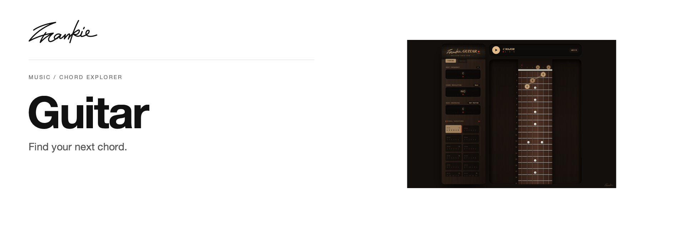

# Frankie Guitar

Find a chord, compare its voicings, and see where the notes sit on the fretboard.

[Guide](docs/guide.md) · [Run locally](#run-locally)

## What it does

- Choose a root, chord quality and bass note, then browse available voicings.
- Adjust tuning, capo and handedness to match your instrument.
- Show chord notes, intervals and scale positions on the fretboard.

## Run locally

```sh
npm ci
npm run dev
```

Open the local URL printed by Vite.

## Before you start

Tuning, capo and left-handed settings change how the fretboard is displayed. The project guide lists supported tunings, controls and source locations.

## For developers

```sh
npm run build
```

[Project guide](docs/guide.md) · [Artwork](docs/readme/README.md)

---

Made by [Songhai Fan](https://github.com/SonghaiFan) · A Frankie project · [License notes](docs/guide.md#license)
