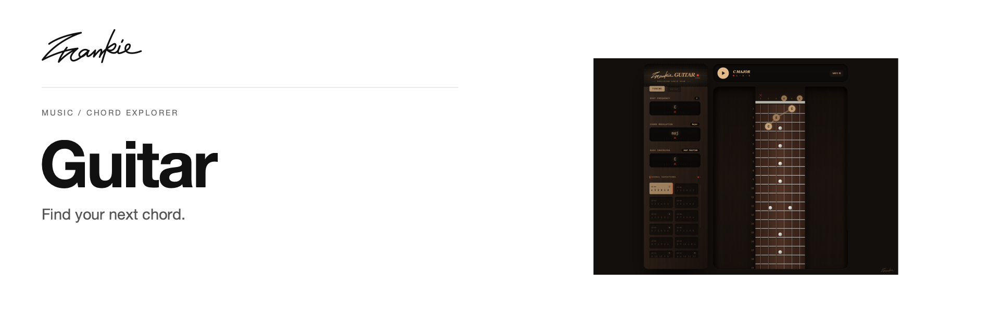

# Frankie Guitar

[English](README.md) · [简体中文](README.zh-CN.md)

查找和弦，比较不同指型，查看音符在指板上的位置。

[介绍页](https://songhaifan.github.io/frankie-guitar/zh/) · [项目指南](docs/guide.md) · [本地运行](#本地运行)

## 可以做什么

- 选择根音、和弦类型与低音，浏览可用指型。
- 按自己的乐器调整调弦、变调夹与惯用手。
- 在指板上显示和弦音、音程与音阶位置。

## 本地运行

```sh
npm ci
npm run dev
```

打开 Vite 输出的本地地址。

## 开始之前

调弦、变调夹和左手模式会改变指板的显示方式。支持的调弦、操作与源码位置见项目指南。

## 开发说明

```sh
npm run build
```

[项目指南](docs/guide.md) · [Banner 维护](docs/readme/README.md)

---

由 [Songhai Fan](https://github.com/SonghaiFan) 制作 · Frankie 系列项目 · [许可说明](docs/guide.md#license)
